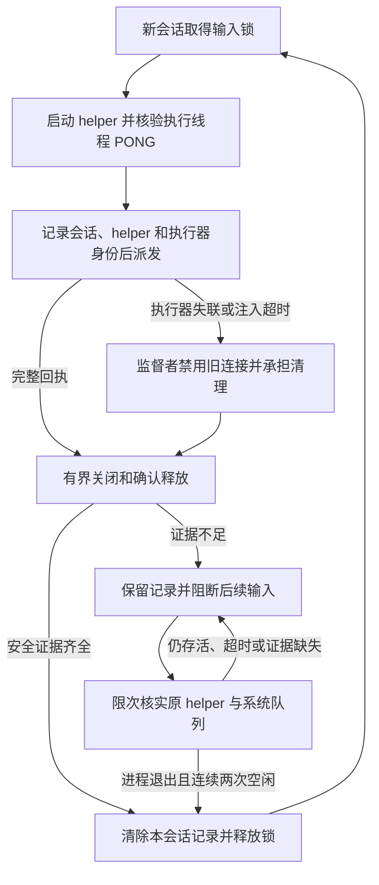

# DeltaHarmonica 2.4.0-rc.5 可靠性验收

## A. rc.4 基线与原因调查

独立 Codex worktree 位于 `root-continuous-timeline/DeltaHarmonica`。开始时 `feature/root-continuous-timeline` 工作树和暂存区均干净，本地、`origin` 和打开的草稿 PR #3 均指向 `ca6be4d`。rc.4 的验收证据中三个 JVM 变体各 389 项通过，Android 16 隔离模拟器 32 项通过。历史归档补丁只涉及版本、焦点解析和旧释放标记，相关逻辑已由 rc.4 重构接管。

| 层级 | rc.4 的所有者与退出路径 | 可证实的限制 |
| --- | --- | --- |
| 应用协程 | 悬浮窗 owner 持有播放器，`RootBackend` 持有连接租约和两个 Mutex。协程的 `finally` 触发清理 | helper 的异步退出没有独立的后端租约监督，清理主要依赖调用者回到 `finally` |
| 应用通信线程 | 连接创建管道读线程和有界优先写线程。关闭等待终止回执，超时后终止本次 Java Process 句柄 | 优先 STOP 不能抢占一次已经陷入内核的管道写。Java Process 可能是 su 包装进程。关闭包装进程无法证明实际 app_process 已退出 |
| helper 的执行线程 | 每个 PLAY 或 RUN 创建一个 daemon 线程，持有活动触点。stdin 控制线程读 STOP、PING，另有 stdout 回报线程 | Android InputManager 的同步注入可阻塞 worker。STOP 设置停止标志并唤醒 worker。PING 只证明 stdin 路径仍运行。worker 阻塞时，无独立监督者判断注入何时失效 |
| Android 系统 InputDispatcher | Android inputflinger 管理全局输入队列和窗口触点；helper 通过定向 UID 的注入 API 访问 | 系统服务由 Android 管理。应用可验证可读的 dispatcher 状态，并隔离自身 helper。系统层永久无响应时只能保留阻断 |

rc.3 同次启动标记保留导致已退出 helper 仍无法开播，rc.4 已用会话 ID、PID 和启动 tick 解决可验证的残留状态。rc.4 的恢复证据是独立查询到旧 helper 退出且连续两次 Android dispatcher 空闲。rc.5 保留这条安全约束，增补应用侧租约监督、helper 内执行监督以及具备明确上限的重试。rc.4 已有优先 STOP、无回执不释放和正常 helper 崩溃 A→B 路径，继续作为回归。

rc.2 日志在 20:44:09.381 记录零基索引 341 的有效 DOWN 与 UP，随后于 20:44:09.776 记录 `completed=342 remaining=18 stopped=false cleanup=ACKNOWLEDGED failure=Cancelled`。计划共 360 音。操作者确认当时留在口琴界面而且未操作。rc.2 的 2× 日志有完整 360 次，rc.3 的第一音后释放拒绝属于另一次测试。原始日志缺失终止触发者和第 343 音回报，结论为 **HISTORICAL_ROOT_CAUSE_UNCONFIRMED**。 [历史验收](ROOT_CONTINUOUS_TIMELINE.md) · [rc.4 恢复基线](ROOT_RECOVERY_REPORT.md)

rc.2 源码 `9ae7dde` 把音量停止、通信关闭、stdin EOF 和心跳到期归入相同中断分支。悬浮窗同一回调涵盖主动 STOP 与环境失效，旧播放器只记录通用取消。rc.5 独立记录触发者、首个环境失效、helper 故障和 Cleanup 结果，保留自然结束的完整计数。

rc.4 使用按键释放后的物理间隔、音区先于半音，以及最小按住时值。密集 2× 仍有不可同时满足的按住和重触发约束。独立舍入缩放后的起点和时值还可能造成 1 ms 的绝对结束误差。软件侧同时核对绝对时值边界、冲突索引和迟到处理。历史三个短弱音的音量原因待游戏录音验证。

## B. 实施与验收顺序

1. 保留现有 389 项 JVM 和隔离包测试，新增执行器监督、独立 STOP、会话与执行器帧身份测试。
2. 用后端租约接管 helper 异常清理，持久化释放记录保留到完整的系统证据成立。并行恢复请求共享互斥边界，有界重试后显示失败。
3. 复验 340～360、最后一音 UP 和 END，增加密集和长曲两档的软件时序矩阵，以及正常与故障循环的资源计数。
4. 通过主机、隔离模拟器、签名和 GitHub 交付验收，真实游戏与真实手机结果列为 NOT TESTED。

### 执行器、协议与恢复



- `RootDispatcherWatchdog.kt` 为 helper 的长期 worker 跟踪操作、原生注入和 STOP 截止时间。命令读取与注入运行在不同线程。超时监督线程可阻止后续 DOWN，在回执窗口内报告故障，并仅终止自身 helper 进程。注入候选上限为 1,200 ms，STOP 后清理候选上限为 800 ms，传输关闭期限为 1,000 ms。系统 InputDispatcher 无响应时保留释放待确认。音量键设备发现独立于握手，实际可用性待真机测试。
- `RootGestureConnection.kt` 和 `RootSequenceProtocol.kt` 的 v4 帧携带 Session ID、Dispatcher ID 和操作序号。READY 后需要执行线程回送 PONG，普通控制心跳独立。旧会话或旧操作的回包不能完成当前音符。STOP 由独立任务抢占等待发送的普通消息，内核中的写阻塞由有界超时和所属进程退出路径处理。
- `RootBackend.kt` 在应用进程内监督租约，协程回调丢失时也能接手工具进程的故障清理。`RootReleaseGuard.kt` 保留 rc.3、rc.4 记录读取并追加 Dispatcher ID。只读查询无法证明窗口收到动作，持久记录只在有效终止回执或独立退出与空闲证据成立、且写入成功时清除。
- 恢复期间拒绝新会话。每次最多三轮，探测总预算为 5.5 秒，仍在退出或系统探测超时时才短间隔重试。每条未决记录允许一次自动恢复操作，之后可以在设置里再次显式核验。已有 PIDs、队列、锁、异常和释放结果按会话隔离。已知活动触点显示数量，丢失回执时显示未知。
- Cleanup 结果随原连接保留，延迟调用可读取旧结果。无故障码的终止回执也会触发后端清理。无障碍后端在共享输入 Mutex 内重核 Root 释放阻断，关闭预检与实际触控之间的竞争窗口。

## C. 故障与资源验证

应用侧压力用例重复创建真实连接对象与后端租约，通过伪 helper 传输协议帧。正常循环 1,000 次检查唯一 Session/Dispatcher ID、两把锁、已提交的日志记录、进度、触点、两端模拟管道和观察协程。故障循环 1,000 次横跨 10 种情形，包括启动失败、RUN 前退出、DOWN 后退出、执行器卡住或异常、STOP 超时、UP 后丢回复、日志确认失败、系统状态查询超时及撤销授权。未确认释放时先断言新会话被阻断，再提供明确的离线证据恢复。

定向故障另覆盖取消协程、陈旧回包、重复 Cleanup、恢复并发、重试上限、自然结束与 STOP 竞争、写管道阻塞及 helper 终止。统计 JVM 中实际通信线程、后端监督协程和测试替身持有的句柄；Android 原生进程、Binder 和内核文件描述符仍需适当的设备环境测量。

最终 Debug JVM 的专项组计数如下，循环中的各次会话由同一个测试方法计数。

| 范围 | 通过 | 失败 | 跳过 |
| --- | ---: | ---: | ---: |
| 会话、并发恢复和资源 | 13 | 0 | 0 |
| 执行器监督故障和通信 | 24 | 0 | 0 |
| Dispatcher 探测与输入锁 | 9 | 0 | 0 |
| 播放状态与 STOP 竞争 | 26 | 0 | 0 |
| 整曲及虚拟调度 | 10 | 0 | 0 |

最终 Debug 压力结果如下。故障组有 100 次启动失败，其余 900 次均创建并关闭了模拟 helper。

```text
NORMAL sessions=1000 executors=1000 helpersClosed=1000 observers=0 pipeThreads=0 initialThreads=0
FAULTS total=1000 perClass=100, 100, 100, 100, 100, 100, 100, 100, 100, 100 helpersClosed=900 observers=0 pipeThreads=0 initialThreads=0
```

## D. 无重启恢复

同一个 `RootBackend` 的验证覆盖 A 注入后收到执行器超时、监督者接手 Cleanup、系统仍有触点时阻断，以及独立证明成立后 B 使用新执行器完成演奏。另有无故障码的终止回执回收租约、同一记录重复恢复和旧回调到达新会话期间的验证。

摘自最终 `RootSessionRecoveryTest` 的 stdout，省略转换日志中与状态无关的字段。

```text
A_START=1bd4bf18-9525-45bf-a08c-0e24d64ac27e DOWN=1 FAULT=NATIVE_TIMEOUT CLEANUP=REJECTED
session=1bd4bf18-9525-45bf-a08c-0e24d64ac27e phase=CLEANING lock=LOCK_HELD
session=1bd4bf18-9525-45bf-a08c-0e24d64ac27e phase=RECOVERY_REQUIRED lock=LOCK_RELEASE_UNCONFIRMED
session=1bd4bf18-9525-45bf-a08c-0e24d64ac27e phase=RECOVERING lock=LOCK_RECOVERY_REQUIRED
session=1bd4bf18-9525-45bf-a08c-0e24d64ac27e phase=IDLE lock=LOCK_FREE recovery=CONFIRMED
A_RELEASE_PROOF=CONFIRMED B_START=9456d10a-f751-405f-9f2a-822d51d17637 DISPATCHER_REBUILT=f623342e-d7fb-4901-bc4b-9fc59aac4af3
B_DONE=Completed B_RELEASE=ACKNOWLEDGED FINAL=IDLE
WIRE fullSongUploaded=360 boundary=340..345 complete=360 finalUp=true end=true cleanup=ACKNOWLEDGED
```

## E. 软件调度

虚拟时钟分别记录计划、模拟触点回执和完成状态。倍速根据绝对 Note On 与 Note Off 计算起点和时值，调整局限于逐音分析和已标出的物理约束。音区变化仍先于半音，控制动作松开后再触发音键。严重迟到在派发前留下有索引的失败事件，后续过期音符停止派发。Windows 实现只作为绝对时钟与间隔设计的参考。 [上游调度说明](https://github.com/Dr-hydra/Delta-Force-Harmonica/blob/main/docs/DESKTOP.md#L105-L139)

| 样本 | DOWN / UP / 完成 | 计划 / 模拟用时 ms | 平均 / 最大 / P95 / P99 迟到 ms | 首末起音相对原谱漂移 ms |
| --- | ---: | ---: | ---: | ---: |
| B-full-360 1× | 360 / 360 / 360 | 179,964 / 179,968 | 0 / 0 / 0 / 0 | 0 |
| B-full-360 2× | 360 / 360 / 360 | 90,125 / 90,129 | 0 / 0 / 0 / 0 | 51 |
| C-dense-32 2× | 32 / 32 / 32 | 4,385 / 4,389 | 0 / 0 / 0 / 0 | 2,317 |
| B 1× 第 342 音后可恢复迟到 | 360 / 360 / 360 | 179,964 / 179,968 | 0.27 / 49 / 0 / 0 | 0 |
| B 2× 第 342 音后可恢复迟到 | 360 / 360 / 360 | 90,125 / 90,178 | 2.45 / 49 / 0 / 49 | 100 |

第 342 音后超出预算时，两档都保留 342 音完整回执，未开始 18 音，其中第一音有索引失败记录。末音按住时 STOP 两档均释放第 360 个 UP，完整计数 359、取消 1。自然结束用例要求第 360 个有效 UP 和匹配 END。

混合负载的每个规模在 1× 与 2× 都逐音完成，无取消、无失败，结束后没有模拟活动指针。工况包含一次 731 ms 暂停、每四音注入一次 5 ms 迟到以及固定 2 ms 注入成本。两档各组的平均迟到为 1.25 ms，最大值、P95、P99 均为 5 ms。

| 规模 | 两档分别完成 | 两档各自的累计派发迟到 ms | 首末起音漂移 1× / 2× ms |
| ---: | ---: | ---: | ---: |
| 8 | 8 / 8 | 10 | 14 / 196 |
| 16 | 16 / 16 | 20 | 5 / 529 |
| 32 | 32 / 32 | 40 | 14 / 756 |
| 360 | 360 / 360 | 450 | 91 / 8,510 |
| 1,000 | 1,000 / 1,000 | 1,250 | 5 / 23,489 |
| 4,096 | 4,096 / 4,096 | 5,120 | 5 / 95,729 |

相对计划的派发迟到与相对原谱的节奏漂移分开统计。密集曲受按住、重触发和控制间隔的约束，2× 仍存在计划拉长。真实游戏发声时间为 **NOT TESTED**。

## F. 构建与签名

源码构建提交为 `d88df65b0b75dd9983cd5b7653a1b8aca0e4c19e`。Gradle 任务清单确认此次使用的 JVM、APK 和 Lint 入口。当前配置沿用 Temurin 21、Gradle 9.9.1、AGP 9.5.1、Kotlin 2.4.21 和 SDK 37.2。

| 验证 | 结果 |
| --- | --- |
| `testDebugUnitTest` | 416 通过，0 失败，0 错误，0 跳过 |
| `testInstrumentedUnitTest` | 416 通过，0 失败，0 错误，0 跳过 |
| `testReleaseUnitTest` | 416 通过，0 失败，0 错误，0 跳过 |
| `lintDebug` | 0 错误，88 警告，7 提示 |
| `assembleDebug`、`assembleInstrumented`、`assembleInstrumentedAndroidTest`、`assembleRelease` | 通过 |
| Android 16 隔离模拟器非 Root Instrumentation | 32 通过，0 失败，0 跳过 |

逐文件检查 rc.4 的 389 个 JVM 测试名称，全部保留并执行。新增 27 项。Cleanup 的陈旧调用保留原会话回执这一新契约由原并发用例直接断言，且继续验证新会话独占输入。

模拟器使用独立的 loopback ADB 服务，USB 枚举关闭。核对了模拟器身份、API 36、APK 包名和安装前后摘要。导入、校准、界面、设置及使用测试响应的在线曲库回归共用时 190.66 秒，终止输出为 `OK (32 tests)`。

Release 包名为 `com.huanhren.deltaharmonica`，`versionName` 为 `2.4.0-rc.5`，`versionCode` 维持 5。同一正式证书验证通过，证书 SHA-256 为 `25A5A0A57BAE88831D3849721D5F9CE69CD438196B82D704999EAC2908739154`。

| 构建 | APK SHA-256 |
| --- | --- |
| `DeltaHarmonica-2.4.0-rc.5.apk` | `94B5F27825E9DC5B84FAFF00A97289AC631B6447CB1A915AC303F38E72F99358` |
| `DeltaHarmonica-2.4.0-rc.5-debug.apk` | `A305622F0CC497800BAEA05A82B7068842CCD411CAACDE051ACE88152B3CAB28` |
| `app-instrumented.apk` | `99A8A6F33F8BECE970200C876D7BA5E53F8386950C79BBD47677B1C5831C7F7A` |
| `app-instrumented-androidTest.apk` | `6FEC0CA42153EDD51F9C92525184B4A4E05718AA3997B668933CEC1EE8D55F1E` |

## G. GitHub

工作分支为 `feature/root-continuous-timeline`。候选代码分为执行器与输入恢复、应用诊断两个提交，并附本报告和中文更新日志。 [草稿 PR #3](https://github.com/HuanHren/DeltaHarmonica/pull/3) · [CHANGELOG](../CHANGELOG.md)

## H. 真机待验收

| 项目 | 状态 |
| --- | --- |
| 小米 23127PN0CC Android 16 的 Root 注入和音量键 | **NOT TESTED** |
| 真实 Android InputDispatcher 卡死、设备侧触点状态与无重启恢复 | **NOT TESTED** |
| 真实游戏 B-full-360 整曲 1× 与 2× | **NOT TESTED** |
| 游戏音高、漏音率、短弱音及音频时序 | **NOT TESTED** |
| 需 Root 的 Android Instrumentation | **NOT RUN** |

系统 InputDispatcher 本身无响应时仍须等待系统恢复，应用保留输入阻断。rc.5 仍为候选版，签名候选文件保留本地。
