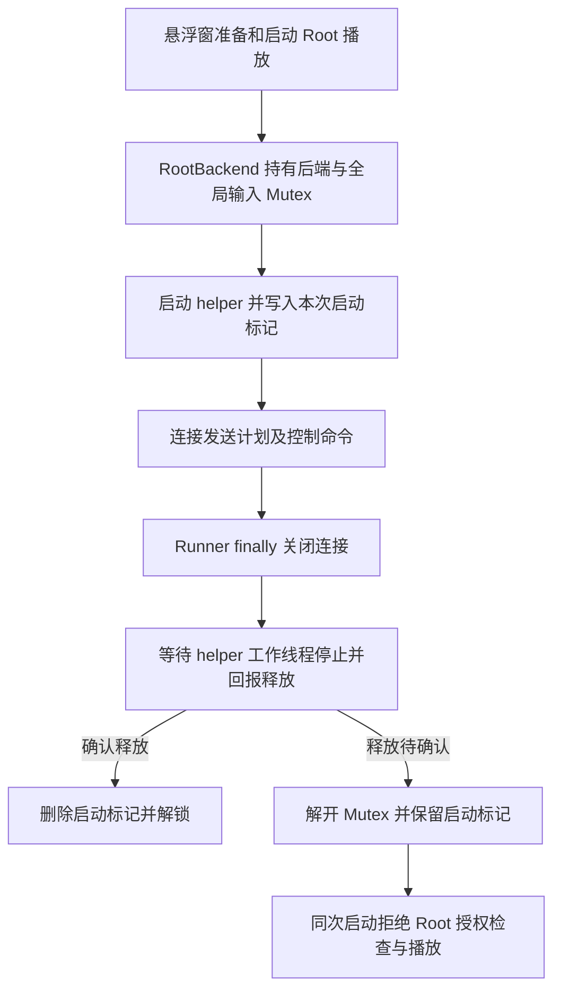
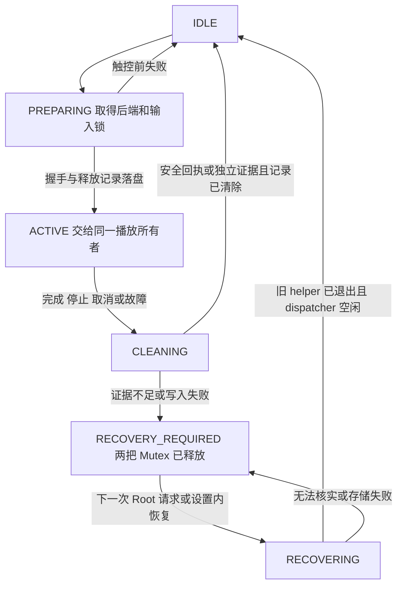

# Root 会话恢复 · 2.4.0-rc.4

## rc.3 审计

开始工作时，`feature/root-continuous-timeline` 工作树干净，本地与 `origin` 均为 `fa80864`，草稿 PR #3 打开。归档草稿可正向应用，无法反向应用，未进入 rc.3 分支。草稿的同次启动重核仅适用于已收到 helper 结束回执的情况。



- `RootBackend.openTouch()` 获取两个进程内 Mutex，`closeTouch()` 在 `finally` 释放。标记 `root_touch_release/session_boot` 既无 helper 身份，也无文件锁语义。同一 boot 中它让授权检查提前返回，解释了旧 helper 退出、系统已经空闲后仍不能开始下一场的现象。启动或清理异常能绕过标记的正常确认，重复关闭也缺少所有者校验。
- Root helper 维护活动触点，在停止或 EOF 时由自身工作线程释放。应用在关闭后等终止回执。STOP 与上传、心跳共用写管道，rc.3 上传阻塞时不能及时观察 STOP。工作线程的阻塞可推迟终止回执。针对游戏 UID 注入的 UP 或 CANCEL 可被拒绝，不能拿拒绝当释放成功，也不能改派到当前窗口。
- rc.3 在拒绝回执后有限次检查 dispatcher，未收到终止回执则没有独立证明，也没有应用内恢复入口。上一轮结束时观察到 helper 已退出、dispatcher 没有活动触点。单独晚到的 NotificationShade 窗口无法确定当时释放被拒的原因。操作者补充当时没有录屏。
- rc.2 的 1× 在 342/360 后收到取消。后续日志无法区分主动停止、意外终止及租约丢失，现有证据无法归因到曲谱约束。rc.2 的 2× 曾派发 360/360。此前密集 2× 录音有 3 个短弱起音，派发成功无法解释游戏端音量。

依据 [上一轮实奏与日志](ROOT_CONTINUOUS_TIMELINE.md)、[AOSP Android 16 InputDispatcher](https://android.googlesource.com/platform/frameworks/native/+/refs/heads/android16-release/services/inputflinger/dispatcher/InputDispatcher.cpp) 和 [AOSP app_process 的进程参数](https://android.googlesource.com/platform/frameworks/base/+/refs/heads/android16-release/cmds/app_process/app_main.cpp)。

## rc.4 会话与恢复



- `RootBackend` 在连接握手后、首个触控指令前持久保存会话 UUID、helper PID、Linux 进程启动 tick、创建时间和系统启动计数。协议 v3 握手校验 UUID 和 helper 身份。每条连接使用独立管道，曲谱操作继续以递增序号关联 ACK、EVENT 和 END。播放器的准备、暂停、恢复与停止由同一悬浮窗所有者控制，过期回调不能重置后续会话。
- 关闭以连接身份取得唯一清理权，同步到达的重复调用等待同一结果。工作线程必须先结束才可回报终止。可确认的 DOWN 进入触点集合，UP 或 CANCEL 生效后从集合移除。清理失败时保留触点 ID 回报或未知状态。进程内锁在 `finally` 释放，持久化释放记录保留到安全证据成立且落盘成功。
- 释放未确认时，`RootRecoveryProbe` 在独立 Root 命令中核实旧进程身份。PID 被复用时比较启动 tick。rc.3 的同次启动标记采用可核验的进程清单查找旧 helper。每次恢复要得到两次前后间隔 100 ms 的有效采样，各自确认进程和 dispatcher 空闲。检查当前触点、待处理事件、输入及命令队列，以及非空的窗口派发队列。旧 helper 仍在、命令出错、dump 缺字段或发现活动输入时保留阻断。
- 用户可在「系统 → Root 授权 → 恢复 Root 输入状态」重新核验。下一次 Root 操作也会尝试一次有界恢复；成功后可启动新 helper。系统只读探测无法提供游戏收到 UP 的证明，Android Binder 和厂商 dump 的可见性也限制了核验范围。旧 helper 尚未退出时不向其他窗口补发 UP 或 CANCEL。
- STOP 的独立观察任务可以在等待上传 ACK 时发出请求，优先写槽先于未写的普通命令。卡死的系统管道仍有硬超时，随后关闭连接并进入清理。已完成的 OK END 可赢得最后一音的停止竞争。超时、断管、主动停止、注入拒绝和释放待确认各有结果。保留暂停前后核对游戏窗口和控制状态的路径。
- `RootSessionState.kt` 和 `RootRecoveryProbe.kt` 新增状态与恢复逻辑。替换 `RootReleaseGuard.kt` 的单一启动戳和 `RootCleanup.kt` 的单次空闲确认路径。`RootGestureConnection.kt`、`RootTouchMain.kt` 和 `RootSequenceProtocol.kt` 管理握手、控制及回执。悬浮窗和设置同步会话所有权，并可以按 UUID 复制最近 8 个会话的诊断，每个会话最多 24 条。

## 计划与软件派发

MIDI 与 DFHS1 沿用曲谱格式及转换来源记录。输入音符、解析配对、单音化片段、映射和计划各有计数。实际派发仅统计有音键 DOWN 回执的记录，释放单列音键 UP 回执。完整完成要求同一音符的 DOWN 和 UP 时序有效，且最终 END 计数与回执一致。控制触点不计入音符，管道中断时观测计数是下限。单音化重叠裁剪、音域不映射和触控物理时值调整分别报告。

虚拟时钟测试将确定性的 SMF 解析和转换后重新读入，经过实际计划器、协议分块解码、调度和触点状态机。模拟注入每次固定耗时 2 ms，起音偏差以最终计划为参考。

| 样本 | 模拟 DOWN / UP | 计划 / 模拟时长 | 音键按住范围 | 相对计划起音偏差 |
| --- | ---: | ---: | ---: | ---: |
| B-full-360 1× | 360 / 360 | 179,964 / 179,968 ms | 120–440 ms | 0 ms |
| B-full-360 2× | 360 / 360 | 90,125 / 90,129 ms | 45–220 ms | 0 ms |
| C-dense-32 2× | 32 / 32 | 4,385 / 4,389 ms | 45–68 ms | 0 ms |

B 两档各执行 293 次音区切换和 316 次半音切换。C 有 28 音延长、3 音裁剪。计划保留所有可映射音高，并指出最紧张的起音间隔及主要约束。默认时序参数沿用 rc.3，短弱音和游戏按键取样仍需录音核对。

## 故障注入、并发及长时间模拟

| 测试组 | 新增 JVM 用例 | 覆盖内容 |
| --- | ---: | --- |
| 会话所有者及恢复探测 | 12 | 启动和日志提交失败、DOWN 后断连、Root 撤权、旧进程/PID 复用、活动触点、无效快照、重复 Cleanup、陈旧回调、协程取消、100 次会话 |
| 通信、协议、触点与 Root 探测命令 | 15 | 6 个断连时点、缺失 END、错序、回执队列饱和、STOP 抢占、音量键竞态、卡住写管道、部分触点释放、探测进程卡住、同一连接各 100 次 STOP 与暂停继续 |
| 曲谱、计划与调度 | 9 | 360 音两档、密集 2×、最后一音被打断、342 音处中断、暂停继续、终止回执时序、10/30/60 分钟虚拟时钟反复整曲 |
| 悬浮窗所有者和焦点 | 6 | 准备阶段 STOP、旧所有者回调、重复恢复、自然完成与晚到 STOP、最早 STOP 时间、只有标题的系统焦点窗口 |

断连矩阵覆盖上传、RUN 之后 START 之前、暂停、继续、停止以及 UP 之后 END 之前。多触点故障另由模拟注入器断言未释放指针集合。持续时钟测试分别完成 7、20、40 次全曲，超过 10、30、60 虚拟分钟。真实 Android 文件描述符、线程和内存的长时间剖析仍待实机验证。

**同进程恢复回归** `RootSessionRecoveryTest.crashWithTouchBlocksThenSessionBPlaysAndReleasesInTheSameBackend`。模拟 helper A 在首个 DOWN 后断开。用同一 `RootBackend` 首先断言活动触点阻止新 helper，随后让 dispatcher 记录空闲。复核通过后清除记录并启动新身份 B，验证完整 DONE、释放回执、无活动触点和空闲锁。旧连接的回调在 B 活动期间执行，B 仍独占输入。

审查后的四项修正覆盖阻塞写入后的精确进程句柄终止、音量键回报顺序、校准操作等待释放确认，以及 dispatcher 连接段和完整性标志的校验。终止请求本身无法确认释放，仍须走进程与 dispatcher 核验。

以下摘自最终 Debug JVM 用例的 stdout，省略 UUID 尾部、时间和重复的准备事件。PID 为模拟值。

```text
session=0f9f66ab… phase=ACTIVE helperPid=100
session=0f9f66ab… phase=CLEANING helperPid=100
session=0f9f66ab… phase=RECOVERY_REQUIRED detail=NO_ACK / DISPATCHER_UNCONFIRMED
session=0f9f66ab… phase=RECOVERY_REQUIRED detail=DISPATCHER_UNCONFIRMED
session=0f9f66ab… phase=IDLE detail=CONFIRMED
session=fc0bf965… phase=ACTIVE helperPid=101
session=fc0bf965… phase=CLEANING helperPid=101
session=fc0bf965… phase=IDLE detail=ACKNOWLEDGED
```

## 构建与签名

环境为 Temurin 21.0.12.1、Gradle 9.9.1、AGP 9.5.1、Kotlin 2.4.21、SDK 37.2、Build Tools 37.0.0。候选源码截至 `02e35a5adf18194d2f7ff1ffffad0b402651fe14`。

| 验证 | 结果 |
| --- | --- |
| `clean` | 通过 |
| `testDebugUnitTest` | 389 通过，0 失败，0 跳过 |
| `testInstrumentedUnitTest` | 389 通过，0 失败，0 跳过 |
| `testReleaseUnitTest` | 389 通过，0 失败，0 跳过 |
| `lintDebug` | 0 错误，88 警告，7 提示 |
| `assembleDebug`、`assembleInstrumented`、`assembleInstrumentedAndroidTest`、`assembleRelease` | 通过 |
| Android 16 隔离模拟器，非 Root Instrumentation | 32 通过，0 失败，0 跳过 |

逐文件比较 rc.3 的 347 个 JVM 用例名称，全部保留并运行，新增 42 项。Debug、隔离宿主、隔离测试 APK 和签名 Release 均按对应变体编译。

模拟器使用独立 loopback ADB 服务和关闭的 USB 枚举。先验证隔离 APK 的包名、签名和摘要，再以显式 emulator serial 核对安装字节。最终的隔离回归用例覆盖导入、校准、界面、设置和带测试响应的在线曲库。运行输出为 `OK (32 tests)`，用时 190.123 秒。

Release 包名为 `com.huanhren.deltaharmonica`，`versionName` 为 `2.4.0-rc.4`，`versionCode` 保留为 5。APK Signature Scheme v2 验证通过。与 rc.3 的签名证书 SHA-256 均为 `25A5A0A57BAE88831D3849721D5F9CE69CD438196B82D704999EAC2908739154`。

| 本地构建 | SHA-256 |
| --- | --- |
| `DeltaHarmonica-2.4.0-rc.4.apk` | `C5110478EB76008A077E5EBA55AD544C8427A431302EFE95D1807C27FC0711C5` |
| `DeltaHarmonica-2.4.0-rc.4-debug.apk` | `58B44286A996DAF2E8E7E406EF63B3D071441D36766E874627B0743E9719FCC0` |
| `app-instrumented.apk` | `9610D5BA8BAAEB1CEF34278164DCABB4F1076F9C6EF77BEF144EF57CCF210F83` |
| `app-instrumented-androidTest.apk` | `0583AAECB7C8FA6205920D35DA1F9CEF09BCC3E0C25690604A1179E19CFA4082` |

## 真机验收

rc.4 未操作实体手机、未启动真实游戏演奏。旧录像为历史依据。

| 项目 | rc.4 |
| --- | --- |
| 小米 Android 16 真机 Root 授权、焦点、锁屏、悬浮窗和恢复 | **NOT TESTED** |
| B-full-360 真实游戏 1×、2× 整曲 | **NOT TESTED** |
| C-dense-32 真实发声、音高、漏音、短弱音及节奏 | **NOT TESTED** |
| 需要真机 Root 的 Instrumentation | **NOT RUN** |

正式稳定发布仍取决于真实游戏发声与恢复验收。PR #3 保持草稿。 [GitHub PR #3](https://github.com/HuanHren/DeltaHarmonica/pull/3)
